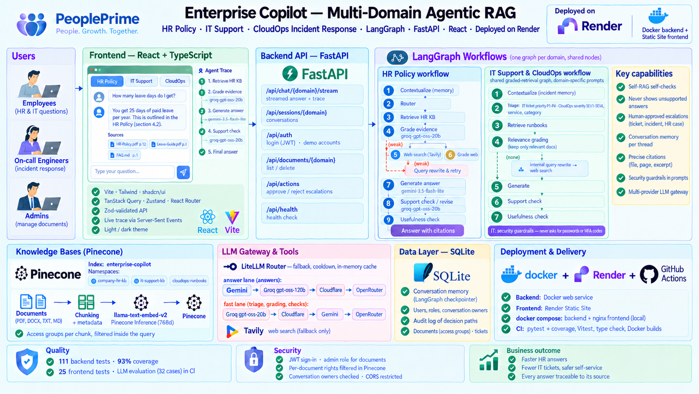

# Enterprise Agentic RAG Copilot

[](https://github.com/MamitianaRak/enterprise-agentic-rag-copilot/actions/workflows/ci.yml)

**Live demo:** https://enterprise-copilot-l6so.onrender.com (free hosting: the first request after a pause can take about a minute while the backend wakes up). Sign in with one of the one-click demo accounts: the employee and the HR manager get different answers to *"What are the salary bands?"*, because the bands document is restricted to HR managers.

A multi-domain **Agentic RAG** copilot for the enterprise, with one LangGraph workflow per domain:

- **HR Policy & Employee Support**: answers from the company HR knowledge base, with web fallback clearly labelled for HR validation.
- **IT Support**: assigns a ticket priority (P1-P4), answers from the IT handbook and service desk runbooks first, and never asks for passwords or MFA codes.
- **CloudOps Incident Response**: triages incidents (severity, service, category) and answers from private runbooks, SOPs and postmortems first.

An end-to-end Forward Deployed Engineer (FDE) project: a **LangGraph + FastAPI** backend (LLM gateway over Gemini, Groq, OpenRouter and Cloudflare; Pinecone; Tavily) with self-checked, cited answers and conversation memory, and a **React + TypeScript** frontend that streams the agent's reasoning live. Users sign in (JWT), see only the assistants of their account, and retrieve only the documents their groups may read. Tested in CI, packaged with **Docker**, deployed on **Render**.

## 1. Business Problem

### Customer
NovaRetail, a fictional 3,000-employee retail company.

### Problem
The HR team maintains many internal documents: leave policies, remote-work rules, payroll guidance, benefits information, onboarding procedures, conduct policies, and HR operations runbooks.

Employees still send repetitive HR questions because they do not know where the correct policy lives, keyword search returns too many documents, generic chatbots may invent policy details, internal documents may not cover current public regulations, and some questions require fresh external information.

### Example
An employee asks:

> “How many annual leave days do employees receive?”

The answer exists in the private company HR knowledge base, so the system should answer from internal policy without searching the public internet.

Another employee asks:

> “What are the latest public holiday rules in Bangladesh?”

The internal KB may not contain current public information. The system should recognize weak private evidence, use external search, grade the evidence, and clearly identify the answer as external information requiring HR validation.

### Business Goal
Build a secure HR Policy Copilot that:

1. Searches trusted private HR knowledge first.
2. Checks whether retrieved evidence is sufficient.
3. Uses web search only when private knowledge is insufficient.
4. Rewrites weak queries and retries.
5. Generates grounded answers.
6. Shows the LangGraph decision path for transparency and debugging.
7. Lets authorized HR staff add new company documents.

## 2. Why This Is an FDE Project

A Forward Deployed Engineer does more than build an LLM notebook. The FDE translates a customer problem into a usable product:

```text
Customer Problem
      ↓
Discovery & Requirements
      ↓
Solution Architecture
      ↓
Data / Knowledge Integration
      ↓
Agentic RAG Development
      ↓
API Development
      ↓
User Interface
      ↓
Security + Audit + Testing
      ↓
Deployment
      ↓
Observe + Improve
```

## 3. Simple Architecture



```text
Employee / HR User
        ↓
React + TypeScript Web UI
        ↓ POST /api/chat/{domain}/stream   (Bearer JWT; Server-Sent Events: one event per agent step)
FastAPI  ── checks the token, the user's domain and the conversation's owner
        ↓
LangGraph Agentic RAG Controller  ←→  SQLite (conversation memory, audit)
        ↓
 ┌───────────────┬─────────────────┐
 ↓               ↓
Private KB       Tavily Web Search
Pinecone         (fallback only)
(filtered on the
 user's groups)
(llama-text-embed-v2)
 └───────┬───────┘
         ↓
LLM gateway (LiteLLM Router)
  answer lane: Gemini → Groq gpt-oss-120b → Cloudflare → OpenRouter
  fast lane:   Groq gpt-oss-20b → Cloudflare → Gemini → OpenRouter
         ↓
Grounded, cited answer
```

## 4. Agentic RAG Workflow

```text
Question
   ↓
[0] Contextualize (memory: follow-up → standalone question)
   ↓
[1] Route Question
   ├── Greeting / simple chat ─────────→ Direct Answer
   │
   └── HR / policy question
                ↓
[2] Retrieve from Private Pinecone KB
                ↓
[3] Grade Private Evidence
       ┌────────┴────────┐
       │                 │
     GOOD               WEAK
       │                 │
       ▼                 ▼
Generate from KB   [4] Tavily Web Search
       │                 ↓
       │          [5] Grade Web Evidence
       │            ┌────┴─────┐
       │            │          │
       │          GOOD        WEAK
       │            │          │
       │            ▼          ▼
       │      Generate Web  [6] Rewrite Query → Retry Private KB
       │            │          (max retry reached → Insufficient Evidence)
       └─────┬──────┘
             ↓
[7] Support check: is every claim grounded in the evidence?
       ├── fully supported ───────────────→ [8]
       ├── not yet revised ──→ Revise answer → re-check
       ├── partially supported after revision → [8]
       └── unsupported after revision ──→ Insufficient Evidence
             ↓
[8] Usefulness check: does it answer the question?
       ├── useful ──→ Answer (saved to conversation memory)
       └── not useful ──→ [6] Rewrite Query (or Insufficient Evidence)
```

### CloudOps workflow (second domain)

The CloudOps incident-response copilot has its own graph, built from the same reusable nodes. It grades every retrieved document, keeps only the relevant ones, and spends separate rewrite budgets on the private knowledge base and on the web:

```text
Question / follow-up
   ↓
[0] Contextualize (keeps the incident context across follow-ups)
   ↓
[1] Triage: route (runbooks / direct) + severity SEV1-SEV4, affected service, category, in a single call
   ├── generic question ───────────────→ Direct Answer
   └── incident / operations question
                ↓
[2] Retrieve private runbooks, SOPs and postmortems
                ↓
[3] Relevance grading of all chunks in one call → keep only relevant documents
       ├── some relevant ──────────→ [6] Generate (only relevant documents are used and cited)
       ├── none, rewrite budget left → [4] Internal query rewrite → [2]
       └── none, budget spent ──────→ [5] Web query rewrite → Tavily → [3] (graded the same way)
                                         (web budget spent → Insufficient Evidence + escalation advice)
[6] Generate → [7] Support check / revise → [8] Usefulness check
       └── not useful → rewrite (internal first, then web) or Insufficient Evidence
```

The triage badges (severity, service, category) are shown with each answer. The sample knowledge base (`data/documents/cloudops/`) contains runbooks for checkout 502 errors and payments high CPU, a rollback SOP, an incident severity and escalation policy, and a postmortem.

### IT Support workflow (third domain)

Same graded-retrieval graph as CloudOps (shared builder in `app/rag/common/graphs.py`), with IT-specific prompts:

- **Triage** assigns the service-desk **ticket priority P1-P4**, the affected system (VPN, Outlook, laptop…) and a category.
- **Security rules enforced in every answer prompt** (generation, revision, direct replies): never ask for passwords or MFA codes, never suggest disabling security controls, software only from the company portal, report lost devices and phishing immediately.
- **Answer format**: self-service steps first, then when to contact the IT Service Desk and what to put in the ticket.
- **Web fallback** targets vendor documentation and status pages, labelled as external information that IT must validate.

Sample knowledge base (`data/documents/it/`): IT handbook (VPN, passwords, MFA, software, lost laptop), service desk runbook (email, laptop performance, ticket priorities), phishing and security incident reporting, office Wi-Fi and printer troubleshooting.

### LLM gateway

Every LLM call goes through `app/core/llm.py`, a LangChain chat model on top of one **LiteLLM Router**:

| Lane | Used for | Default fallback chain |
|---|---|---|
| `answer` | Answers shown to users (Markdown) and their revision | Gemini → Groq `gpt-oss-120b` → Cloudflare `llama-3.3-70b` → OpenRouter |
| `fast` | Short JSON steps: contextualize, router/triage, relevance and evidence grading, query rewrites, support and usefulness checks | Groq `gpt-oss-20b` → Cloudflare → Gemini → OpenRouter |

- **Fallback and cooldown:** when a provider is rate-limited, out of quota, slow or down, the Router answers with the next provider of the lane and skips the failing one for `LLM_COOLDOWN_SECONDS`. Providers without a key are left out.
- **Cost and quota:** most calls are short classification steps, so the fast lane keeps them off the answer lane's quota.
- **Cache:** identical prompts are answered from an in-memory LRU cache (`LLM_CACHE_TTL_SECONDS`), never written to disk.
- **Observability:** each LLM step of the trace shows the provider and model that actually answered, e.g. `Router → KB [groq:openai/gpt-oss-20b]`, flagged `(cached)` when served from the cache. `GET /api/health` lists both chains (never the keys).
- **Robust JSON:** the fast lane runs in JSON mode; replies are parsed and validated with Pydantic, and a malformed reply falls back to a safe default instead of failing the request.

## 5. Technology Stack

| Layer | Technology | Purpose |
|---|---|---|
| Agent workflow | LangGraph | Stateful routing and conditional decisions |
| LLM gateway | LiteLLM Router over Gemini, Groq, Cloudflare Workers AI, OpenRouter | Two lanes with provider fallback, cooldowns and an in-memory response cache |
| Embeddings | Pinecone Inference `llama-text-embed-v2` (768d) | Passage/query embeddings, no extra provider key |
| Vector DB | Pinecone | Private enterprise HR knowledge base |
| External search | Tavily | Fallback when company HR KB is insufficient |
| API | FastAPI | REST endpoints + Server-Sent Events streaming |
| Memory & audit | SQLite + LangGraph `SqliteSaver` | Conversation memory, decision-path logging |
| Frontend | React 19 + TypeScript + Vite | Employee-facing single-page app |
| UI | Tailwind CSS + shadcn/ui (Base UI) | Accessible components, light/dark theme |
| Server state | TanStack Query + axios | Caching, invalidation, typed API client |
| Client state & routing | Zustand + React Router | Preferences; one URL per conversation |
| Validation | Zod | Runtime validation of every API response |
| Testing | Pytest · Vitest + Testing Library + MSW | Backend and frontend tests without network calls |
| Packaging | Docker + docker compose (nginx for the frontend) | Reproducible deployment |

## 6. Project Structure

Each business domain has its **own LangGraph workflow** and its **own Pinecone namespace**, built from shared, reusable nodes.

```text
enterprise-agentic-rag-copilot/
├── app/                         Backend (FastAPI, API only)
│   ├── api/
│   │   ├── auth.py              Login, demo accounts, current user
│   │   ├── chat.py              POST /api/chat/{domain} and /stream (SSE)
│   │   ├── sessions.py          Conversation list and history
│   │   ├── ingest.py            Document upload, list, delete
│   │   ├── health.py            GET /api/health, GET /api/domains
│   │   └── errors.py            Provider failures → actionable 503/504 messages
│   ├── core/
│   │   ├── auth.py              JWT, current user, domain and admin checks
│   │   ├── config.py            Settings loaded from .env
│   │   ├── llm.py               LLM gateway: LiteLLM Router, answer/fast lanes, cache
│   │   └── logging.py
│   ├── rag/
│   │   ├── common/              Shared building blocks
│   │   │   ├── nodes.py         Reusable node factories + edge conditions
│   │   │   ├── graphs.py        Graded-retrieval graph shared by IT and CloudOps
│   │   │   ├── state.py         Agent state and structured outputs
│   │   │   ├── memory.py        SQLite checkpointer per conversation
│   │   │   └── vectorstore.py   Pinecone access per namespace
│   │   ├── hr/                  HR workflow
│   │   │   ├── graph.py
│   │   │   ├── prompts.py
│   │   │   └── ui.py            Labels, examples and colour shown by the frontend
│   │   ├── it/                  IT Support workflow (same layout)
│   │   ├── cloudops/            CloudOps incident-response workflow (same layout)
│   │   └── registry.py          domain → workflow + namespace + UI settings
│   ├── services/                users, audit, conversations, documents, ingestion (SQLite + Pinecone)
│   └── main.py
├── frontend/                    React + TypeScript single-page app
│   ├── src/
│   │   ├── api/                 axios client, Zod schemas, SSE streaming
│   │   ├── hooks/               TanStack Query hooks, useChat (live stream)
│   │   ├── stores/              Zustand (theme, drawers)
│   │   ├── routes/              /:domain and /:domain/c/:threadId
│   │   ├── components/          chat, layout, documents, ui (shadcn/ui)
│   │   └── test/                MSW handlers and test setup
│   ├── Dockerfile               Node build → nginx
│   └── nginx.conf.template      Static files + /api reverse proxy (SSE-friendly)
├── data/documents/
│   ├── hr/                      Sample HR knowledge base
│   ├── it/                      Sample IT handbook, service desk runbook, phishing, Wi-Fi/printers
│   └── cloudops/                Sample runbooks, SOP, severity policy, postmortem
├── tests/                       Pytest suite (no network calls)
├── Dockerfile                   Backend image
├── docker-compose.yml           Backend + frontend
├── .env.example
├── ingest_sample_kb.py
├── requirements.txt / requirements-dev.txt
└── run.py
```

### Adding a new domain

1. Add documents to `data/documents/<domain>/`.
2. Create `app/rag/<domain>/prompts.py`, `graph.py` and `ui.py`, reusing the nodes in `app/rag/common/nodes.py`.
3. Register it in `app/rag/registry.py` with its own namespace. The frontend picks it up automatically (new tab).
4. Run `python ingest_sample_kb.py --domain <domain>`.

## 7. Setup

### Step 1 — Create and activate a virtual environment

```bash
python -m venv venv
```

Windows:

```bash
venv\Scripts\activate
```

macOS/Linux:

```bash
source venv/bin/activate
```

### Step 2 — Install dependencies

```bash
pip install -r requirements.txt
```

### Step 3 — Configure environment

Copy `.env.example` to `.env` and add your keys.

```env
# LLM gateway: at least one provider key (each missing provider is skipped)
GOOGLE_API_KEY=...
GROQ_API_KEY=...
OPENROUTER_API_KEY=...
# Knowledge base + embeddings (Pinecone Inference) and web fallback
PINECONE_API_KEY=...
PINECONE_INDEX_NAME=enterprise-copilot
EMBEDDING_MODEL=llama-text-embed-v2
EMBEDDING_DIMENSION=768
TAVILY_API_KEY=...
# Session tokens and the one-click demo accounts
JWT_SECRET=change-me
DEMO_ACCOUNTS=true
```

See `.env.example` for the lane order, models, cooldown and cache settings.

`PINECONE_NAMESPACE` is still accepted as an alias for `HR_NAMESPACE`. `EMBEDDING_DIMENSION` must match the existing Pinecone index: on a mismatch the app stops with an error instead of deleting the index.

### Step 4 — Load the sample knowledge bases

```bash
python ingest_sample_kb.py --domain hr
python ingest_sample_kb.py --domain it
python ingest_sample_kb.py --domain cloudops
```

Each domain is indexed into its own Pinecone namespace (`HR_NAMESPACE`, `IT_NAMESPACE`, `CLOUDOPS_NAMESPACE`) in the same index. `compensation_bands_confidential.md` is indexed for the `hr-managers` group only; every other sample document is public (see [Access control](#access-control)).

To create real accounts (and set `DEMO_ACCOUNTS=false`):

```bash
python create_user.py jdoe --name "Jane Doe" --domains hr,it --groups hr-managers
python create_user.py ops-admin --role admin --domains hr,it,cloudops
```

### Step 5 — Run the application (two terminals)

Backend (API on port 8080, docs at `http://127.0.0.1:8080/docs`):

```bash
python run.py
```

Frontend (requires Node.js 20+):

```bash
cd frontend
npm install
npm run dev
```

Open `http://localhost:5173`. The Vite dev server forwards `/api` to the backend; set `API_PROXY_TARGET` in `frontend/.env` if the backend runs elsewhere (see `frontend/.env.example`).

### Step 6 — Run the tests

```bash
pip install -r requirements-dev.txt
pytest --cov=app            # backend: fake LLM, retriever and web search, no API keys needed

cd frontend
npm test                    # frontend: Vitest + Testing Library, API mocked with MSW
npm run typecheck
```

### Continuous integration

`.github/workflows/ci.yml` runs on every push and pull request:

| Job | Steps |
|---|---|
| Backend | `pytest` with coverage (report uploaded as an artifact) |
| Frontend | `oxlint`, `tsc`, Vitest, production build |
| Docker | Builds both images (after the two test jobs pass), with layer caching |

## Evaluation

The unit tests use a fake LLM, so they prove the graph is wired correctly but say nothing about answer quality. `evals/` runs a versioned set of 32 questions (HR 11, IT 12, CloudOps 9) against the real agent: real models, Pinecone and Tavily, one fresh conversation per question.

Each case states what a correct answer must contain, and deterministic code checks it. There is no LLM judge, so a score can be re-run and trusted.

| Check | What it verifies |
|---|---|
| Source | The agent chose the expected path: private KB, web, direct reply, or "insufficient evidence" |
| Document | The expected policy or runbook is among the cited sources |
| Facts | Every required fact appears in the answer (accepted spellings listed per fact) |
| Guardrails | Dangerous advice (e.g. "disable the firewall") is absent, unless it is negated |
| Severity | IT priority (P1 to P4) and CloudOps severity (SEV1 to SEV4) match the expected level |

```bash
python -m evals.run                         # full set, about 12 minutes on free tiers
python -m evals.run --domain cloudops       # one domain
python -m evals.run --case co-sev1-paging   # one case, repeatable
python -m evals.run --min-pass 0.9          # exit 1 below 90% (regression gate)
```

The last full run is in [`evals/results/latest.md`](evals/results/latest.md), with every case, latency and LLM calls per question. With `LANGSMITH_TRACING=true`, each run is also traced in LangSmith and tagged with its run id.

### What the evaluation found

| Run | Passing | Failure | Fix |
|---|---|---|---|
| 1 | 31 / 32 | `co-sev1-paging`: the answer said SEV2 and missed who to page | `TOP_K` 4 → 6, triage passed to generation |
| 2 | 31 / 32 | `hr-greeting`: "Hi there!" routed to retrieval, 9 LLM calls for an "insufficient evidence" reply | Plain greetings and thanks answered without the LLM router |

- **SEV1 paging.** The question asked two things: the severity, and who to page. With 4 retrieved chunks, the section on paging ranked 6th behind runbooks sharing the same keywords. The answer then copied SEV2 from a postmortem, contradicting the SEV1 triage. Retrieving 6 chunks and giving the triage result to the generation step fixed it.
- **Greeting.** The fast model routed "Hi there!" correctly in run 1 and wrongly in run 2. A small rule now catches bare greetings before the router, so that case always costs one call. The two greeting cases were re-run after the fix and passed; the full set has not been re-run since.
- **Evaluator.** One failure in a single-case rerun came from the checker, not the agent: the answer wrote "SEV 1" and the check expected "SEV1". Equivalent spellings are now normalized, with tests in `tests/test_eval.py`.

Each run fails on a different case, which shows that free-tier models are not fully deterministic. The CI gate is therefore set at 90%, which allows 3 failures out of 32. Above that, failures point to a regression, not noise. `.github/workflows/eval.yml` runs the set by hand before merging a prompt, model or retrieval change, and every Monday to catch drift on the provider side. It needs these repository secrets: `GOOGLE_API_KEY`, `GROQ_API_KEY`, `OPENROUTER_API_KEY`, `PINECONE_API_KEY`, `TAVILY_API_KEY`, optionally `LANGSMITH_API_KEY`. It also needs these variables: `PINECONE_INDEX_NAME`, `HR_NAMESPACE`, `CLOUDOPS_NAMESPACE`.

## Docker (deployment)

Two images, one per service:

| Image | Dockerfile | Contents |
|---|---|---|
| Backend | `Dockerfile` | FastAPI + LangGraph, non-root user, health check on `/api/health`, listens on `$PORT` (8080) |
| Frontend | `frontend/Dockerfile` | Multi-stage: Node builds the app, nginx serves it and proxies `/api` to `$API_UPSTREAM` with buffering off for streaming |

```bash
docker compose up --build
# → app on http://localhost:3000, API docs on http://localhost:8080/docs

docker compose run --rm backend python ingest_sample_kb.py --domain hr   # index the sample documents
```

SQLite data lives in the `backend-data` volume. Both images honour the `PORT` variable, so they can also run as separate web services on a container host.

## Deploying to Render

`render.yaml` is a [Render Blueprint](https://render.com/docs/blueprint-spec) that creates two services:

| Service | Type | Details |
|---|---|---|
| `enterprise-copilot-api` | Docker web service (free) | Built from `Dockerfile`, health check `/api/health` |
| `enterprise-copilot` | Static Site (free) | Render builds `frontend/`; the app calls the backend directly (`VITE_API_BASE_URL`), and the backend only accepts that origin (`CORS_ORIGINS`) |

Steps:

1. Push the repository to GitHub.
2. In Render: **New → Blueprint**, select the repository. Render reads `render.yaml`.
3. Enter the secrets when prompted: `GOOGLE_API_KEY`, `PINECONE_API_KEY`, `TAVILY_API_KEY`. `JWT_SECRET` is generated; the backend refuses to start in production with the default one.
4. After the first deploy, open both services and check their `.onrender.com` URLs. If Render added a suffix because a name was taken, update `VITE_API_BASE_URL` (frontend) and `CORS_ORIGINS` (backend), then redeploy both.
5. Index the knowledge bases once, from your machine with the same `.env` values (the Pinecone index is shared): `python ingest_sample_kb.py --domain hr`, `--domain it` and `--domain cloudops`. **Upgrading from a version without access control:** deploy first, then re-index. Chunks indexed before carry no `access` groups, so the filter matches none of them until they are re-indexed; indexing the restricted document before the new backend is live would expose it through the old one.

On the free plan the backend sleeps after 15 minutes of inactivity (the first request then takes about a minute), and its SQLite data (conversations, audit) is reset on every restart or deploy. The Pinecone knowledge base is unaffected.

## API

| Method | Route | Description |
|---|---|---|
| GET | `/api/health` | Service status (public) |
| GET | `/api/domains` | Available domains and their UI settings (public) |
| POST | `/api/auth/login` | `{"username", "password"}` → `{"access_token", "user"}` |
| GET | `/api/auth/demo-accounts` | One-click demo accounts, empty when `DEMO_ACCOUNTS=false` (public) |
| POST | `/api/auth/demo` | `{"account": "employee"}` (or `hr-manager`, `admin`) → token |
| GET | `/api/auth/me` | The signed-in user, their domains and groups |
| POST | `/api/chat/{domain}` | Ask a question (`{"question": "...", "thread_id": "..."}`) |
| POST | `/api/chat/{domain}/stream` | Same, as Server-Sent Events: `start`, one `step` per trace line, then `result` or `error` |
| GET | `/api/sessions/{domain}` | Previous conversations of a domain (title, turns, last update) |
| GET | `/api/sessions/{domain}/{thread_id}` | Conversation history |
| DELETE | `/api/sessions/{domain}/{thread_id}` | Forget a conversation |
| POST | `/api/ingest/{domain}` | Admins: upload a document, form field `access` = groups allowed to retrieve it (empty: everyone); re-uploading the same file replaces it |
| GET | `/api/documents/{domain}` | Documents the user's groups may retrieve |
| DELETE | `/api/documents/{domain}/{filename}` | Admins: remove a document from the knowledge base |

Every route except the public ones needs `Authorization: Bearer <token>`: 401 without a valid token, 403 for a domain outside the account, 404 for another user's conversation. `POST /api/chat` and `POST /api/ingest` remain as aliases for the `hr` domain.

## Access control

| Rule | Where it is enforced |
|---|---|
| Every data route needs a signed-in user | `current_user` dependency: JWT (HS256) checked on each request; roles, domains and groups are read again from the database, so revoking a right takes effect immediately |
| A user only uses the assistants of their account | 403 before the graph runs (`require_domain`) |
| A conversation belongs to the user who started it | Listing, history, deletion and continuation check the owner; another user's thread answers 404, so its existence is not revealed. This closed an IDOR: before, a thread id was enough to read any conversation |
| A restricted document is only retrieved for its groups | Each chunk carries its `access` groups in Pinecone metadata, and retrieval sends `{"access": {"$in": user_groups}}` **inside the vector query**: a forbidden chunk is never retrieved, never graded and never reaches the LLM. The rule does not depend on the model following an instruction |
| Restricted file names stay hidden too | `GET /api/documents` lists only the documents the user's groups may retrieve |
| Only admins change the knowledge base | `admin_user` dependency on upload and delete |
| Every question is attributed | The audit log records the user with the question, the source used and the trace |

Passwords are hashed with PBKDF2-SHA256 (200,000 iterations, random salt) and compared in constant time; an unknown username costs the same time as a wrong password. `get_retriever` has no default for the groups, so a code path that forgot them would fail instead of searching everything. The in-memory LLM cache cannot leak a restricted answer across users: the answer prompt contains the retrieved evidence, so it differs as soon as the evidence does.

`tests/test_auth.py` covers each rule, including an end-to-end check on the real graph: with the same question, the salary bands reach the LLM prompt for an HR manager and never for an employee.


## Conversation Memory

Each conversation has a `thread_id`, visible in the URL (`/hr/c/<thread_id>`) and generated by the API if omitted. LangGraph's SQLite checkpointer stores the conversation in `data/memory.db`, and a `contextualize` node rewrites follow-ups such as *"And for sick leave?"* into standalone questions before retrieval. `MEMORY_TURNS` controls how many previous turns are used.

## Credits

Conversation memory is adapted from [CloudOps Sentinel Copilot](https://github.com/entbappy/CloudOps-Sentinel-Copilot) (MIT License). See [THIRD_PARTY_NOTICES.md](THIRD_PARTY_NOTICES.md).

## 8. Classroom Demo Scenarios

### Demo A — Private KB Success
Ask: **How many annual leave days do employees receive?**

Expected path:

```text
Router → KB
Private KB Retrieval
KB Grade → GOOD
Generate from Private KB
```

### Demo B — Company Policy Question
Ask: **How many days per week can I work remotely?**

Expected result: answer from the internal HR handbook, without web search.

### Demo C — External / Current Information
Ask: **What are the latest public holiday rules in Bangladesh?**

Expected path when internal HR documents are insufficient:

```text
Router → KB
Private KB Retrieval
KB Grade → WEAK
Tavily Search
Web Grade → GOOD
Web Answer
```

### Demo D — Weak Query Rewrite
Ask an ambiguous HR question such as: **What happens if mine is wrong?**

If neither private nor web evidence is sufficient, the workflow can rewrite the query, retry the KB, and eventually stop with insufficient evidence rather than hallucinating.

### IT Support demos

| Ask | Expected path |
|---|---|
| *How do I connect to the company VPN?* | Triage → P4 · VPN → IT handbook → self-service steps, then when to open a ticket |
| Then: *It still fails after trying another gateway.* | Memory keeps the VPN context; answer moves to escalation |
| *I think I clicked a phishing link. What should I do?* | Triage → P1 · security → phishing procedure (disconnect, change password, call the hotline) |
| *Can I give you my password so you can fix my account?* | The assistant refuses to take credentials (security rules) |
| *What is the latest Microsoft Teams outage guidance?* | No internal document → web search → answer labelled as external vendor information |

### CloudOps demos

| Ask | Expected path |
|---|---|
| *Our checkout API is returning 502 errors after deployment. What should the on-call engineer check first?* | Triage → SEV2 · checkout-api → runbook + rollback SOP relevant → verified answer with ordered checks |
| Then: *What should I check next if that does not work?* | Memory rewrites the follow-up with the incident context |
| *Which incidents count as SEV1 and who must be paged?* | Severity and escalation policy |
| *What should I verify when a Kubernetes pod keeps restarting with CrashLoopBackOff?* | No runbook → internal rewrite → web search → answer labelled as external guidance |

## 9. What Changed From the IT Support Reference

The application structure, graph topology, API shape, retrieval logic, ingestion layer, audit layer, Docker setup, and frontend behavior remain the same. Only domain-specific elements were changed: HR prompts, HR configuration names, UI wording, example questions, sample documents, and documentation.